<p align="center">
  <strong>English</strong> · <a href="./README_ZH.md">简体中文</a>
</p>

<p align="center">
  
</p>

<p align="center">
  <a href="LICENSE"></a>
  <a href="blogcraft/SKILL.md"></a>
</p>

A technical post usually doesn't fail at the writing. It fails earlier: the outline bakes three topics into one heading, the code was never actually run, the figures decorate instead of explaining, and `d` quietly changes meaning halfway through the series.

blogcraft is an Agent Skill built around that observation: **the hard part of a good post isn't producing prose — it's deciding the structure while changes are still cheap, and proving the claims before anyone reads them.** It covers the full arc from a topic sentence to a publishable draft, distilled from a real writing session rather than an idealized flowchart.

```bash
npx skills add Momoyeyu/blogcraft -g
```

## What it actually does



Seven stages, but you only ever make **two blocking decisions**:

- **Approve the outline.** The agent reads your published posts, proposes a heading tree — splits, merges, extra topics worth covering, where each code block will live — and presents it as one review pass. You rule per item; it iterates.
- **Approve the ship.** The agent drafts, runs every code block on real machines, draws the figures, audits the result — then stops. It hands you the diff, the verification report, and the rendered pages. You commit, publish, or send it back.

Between those two gates it's autonomous. Which is the point: prose is cheap to regenerate, structure is not.


## The part most tools skip

The interesting stages aren't drafting — they're **verification** and **audit**. blogcraft checks things writing assistants usually don't:

- **Does the code actually run?** Every block executes on the environments you name — not just "looks right". Asserts test the claimed property (RoPE's relative-position identity, `nn.LayerNorm` parity including backward), not merely that nothing throws.
- **Do the symbols stay honest?** One letter, one meaning — across the post and across the series. A `d` that means embedding dim must not silently become head dim three sections later.
- **Does the figure explain anything?** SVGs earn their place at structure comparisons and dataflows, hand-drawn in the site's existing visual system — CSS variables, dual `prefers-color-scheme` themes — and verified in a running page, light and dark.
- **Does the prose match the series?** Voice, transition habits, notation conventions, and cross-episode API signatures are read from your published posts, not guessed.

And on the way out: the repository's own rules win. `make check`, commit style, `draft` flag — the project's conventions decide, and nothing ships until you say so.

## What you get back

| Moment | Artifact |
|---|---|
| After Intake | Task card — mode, style refs, paper sources, verification envs, gate density |
| After Outline | Heading tree + decision menu — merges, additions, code-slot plan, item by item |
| After Verify | Execution report — per block, per environment, which property was asserted |
| After Illustrate | Figure list + rendered-page evidence in both themes |
| After Review | Audit report — facts, consistency, notation, completeness; fixes already applied or listed for ruling |
| Terminal | Ship report — green checks, scoped diff, judgment calls flagged honestly |

The pipeline also takes partial jobs: auditing an existing post, adding figures to one, or restructuring it — Intake routes you onto the right slice of the loop.

## Try it

Install the skill, then just ask:

```text
Write the next episode on speculative decoding — same series conventions as the MoE post.
```

```text
Audit posts/llm-normalization.md: facts, consistency, notation, code completeness.
```

```text
This post needs figures like the position-encoding one has. Same style.
```

The first request starts with a task card and an outline you rule item by item — no prose before approval. The last two are partial modes: they enter at Review and Illustrate respectively. Publishing anything always waits for your explicit go — that's a hard gate, not a suggestion.

## Skill structure

| File | Load when |
|---|---|
| [`blogcraft/SKILL.md`](blogcraft/SKILL.md) | Entry: pipeline, gates, defaults |
| [`references/intake.md`](blogcraft/references/intake.md) | Starting any task; picks the mode and entry point |
| [`references/outline.md`](blogcraft/references/outline.md) | Planning or restructuring a post |
| [`references/draft.md`](blogcraft/references/draft.md) | Writing prose and code |
| [`references/verify.md`](blogcraft/references/verify.md) | A code block exists or changed |
| [`references/illustrate.md`](blogcraft/references/illustrate.md) | Planning, drawing, or placing figures |
| [`references/review.md`](blogcraft/references/review.md) | Auditing a post before publish |
| [`references/ship.md`](blogcraft/references/ship.md) | Checks, diff, commit, publish |

Progressive disclosure: read the current stage's reference only.

## Development

Diagrams live in `docs/diagrams/` — Archify JSON sources finalized to standalone HTML and exported as auto-themed SVG, plus the hand-drawn brand lockup. Regenerate with `archify finalize <type> <json> <html> --quality showcase`, then Export → SVG from the HTML viewer.

## License

[MIT](LICENSE)
