<p align="center">
  <a href="./README.md">English</a> · <strong>简体中文</strong>
</p>

<p align="center">
  
</p>

<p align="center">
  <a href="LICENSE"></a>
  <a href="blogcraft/SKILL.md"></a>
</p>

一篇技术博客的失败往往不在写作本身，而在更早的地方：大纲把三个话题塞进一个标题、代码从来没被真正跑过、配图只是装饰而不是解释、符号 `d` 写到一半偷偷变了含义。

blogcraft 是一个围绕这个观察做的 Agent Skill：**好文章的难点不是产出文字，而是在改动还便宜的时候定对结构、并在任何人读到之前把断言验证掉。** 它覆盖从一个主题句到可发布草稿的完整链路，流程提炼自真实的写作过程，而不是理想化的流程图。

```bash
npx skills add Momoyeyu/blogcraft -g
```

## 它具体做什么



七个阶段，但你只需要做**两个阻塞性决定**：

- **批准大纲。** Agent 先读你已发布的文章，拿出标题树——拆分、合并、值得补的话题、每段代码放在哪——合成一次完整的评审。你逐项裁决，它迭代。
- **批准发布。** Agent 写正文、在真实环境跑每段代码、画配图、做全文审查——然后停下。它交给你 diff、验证报告和渲染后的页面。你决定提交、发布、还是打回。

两道闸门之间它是自主的。这正是设计意图：正文重写的成本很低，结构不是。


## 大多数工具跳过的那部分

真正值钱的阶段不是写正文，是**验证**和**审查**。blogcraft 会查一些写作助手通常不查的事：

- **代码真的能跑吗？** 每个代码块在你指定的环境上真实执行——不是"看起来对"。断言验证的是声称的性质（RoPE 的相对位置恒等式、与 `nn.LayerNorm` 的对拍含反向），而不只是没报错。
- **符号前后一致吗？** 一个字母一个含义——全篇一致，跨系列一致。`d` 在第二章是 embedding 维度，第六章不能悄悄变成 head 维度。
- **配图真的在解释吗？** SVG 只在结构对比和数据流这种文字说不透的地方出现，手写、沿用站点现有视觉体系——CSS 变量、`prefers-color-scheme` 双主题——并在真实页面里明暗两色各验一遍。
- **文风像系列文章吗？** 语气、转场习惯、符号约定、跨篇 API 签名，都是从你已发布的文章里读出来的，不靠猜。

出口端也一样：仓库自己的规则最大。`make check`、commit 风格、`draft` 开关——项目的惯例说了算，你没点头之前什么都不发。

## 你会拿到什么

| 时机 | 产物 |
|---|---|
| Intake 之后 | 任务卡——模式、文风参考、文献来源、验证环境、闸门密度 |
| Outline 之后 | 标题树 + 决策菜单——合并、增删、代码位规划，逐项裁决 |
| Verify 之后 | 执行报告——逐块、逐环境、断言的是哪条性质 |
| Illustrate 之后 | 配图清单 + 双主题渲染截图证据 |
| Review 之后 | 审查报告——事实、一致性、符号、完整性；已修复项或待裁决清单 |
| 终态 | 交付报告——检查全绿、diff 限界、如实标注的可斟酌点 |

流水线也接局部任务：审查已有文章、补配图、重构结构——Intake 会把你路由到对应的切片上。

## 试试看

装好 skill，直接说：

```text
写下一篇 speculative decoding——沿用 MoE 那篇的系列惯例。
```

```text
审查 posts/llm-normalization.md：事实、一致性、符号、代码完整性。
```

```text
这篇需要配图，风格参照位置编码那篇。
```

第一个请求会先出任务卡和大纲让你逐项裁决——批准之前不写正文。后两个是局部模式：分别从 Review 和 Illustrate 切入。发布任何内容都要等你明确点头——这是硬闸门，不是建议。

## Skill 结构

| 文件 | 何时加载 |
|---|---|
| [`blogcraft/SKILL.md`](blogcraft/SKILL.md) | 入口：流水线、闸门、默认值 |
| [`references/intake.md`](blogcraft/references/intake.md) | 任务开始；选择模式和切入点 |
| [`references/outline.md`](blogcraft/references/outline.md) | 规划或重构文章结构 |
| [`references/draft.md`](blogcraft/references/draft.md) | 写正文和代码 |
| [`references/verify.md`](blogcraft/references/verify.md) | 存在或改动过代码块 |
| [`references/illustrate.md`](blogcraft/references/illustrate.md) | 规划、绘制、放置配图 |
| [`references/review.md`](blogcraft/references/review.md) | 发布前审查文章 |
| [`references/ship.md`](blogcraft/references/ship.md) | 检查、diff、提交、发布 |

渐进式披露：只读当前阶段的 reference。

## 开发

图都在 `docs/diagrams/`——Archify JSON 源文件 finalize 成独立 HTML 后导出双主题 SVG，外加手绘的 brand lockup。重新生成：`archify finalize <type> <json> <html> --quality showcase`，然后在 HTML viewer 里 Export → SVG。

## License

[MIT](LICENSE)
